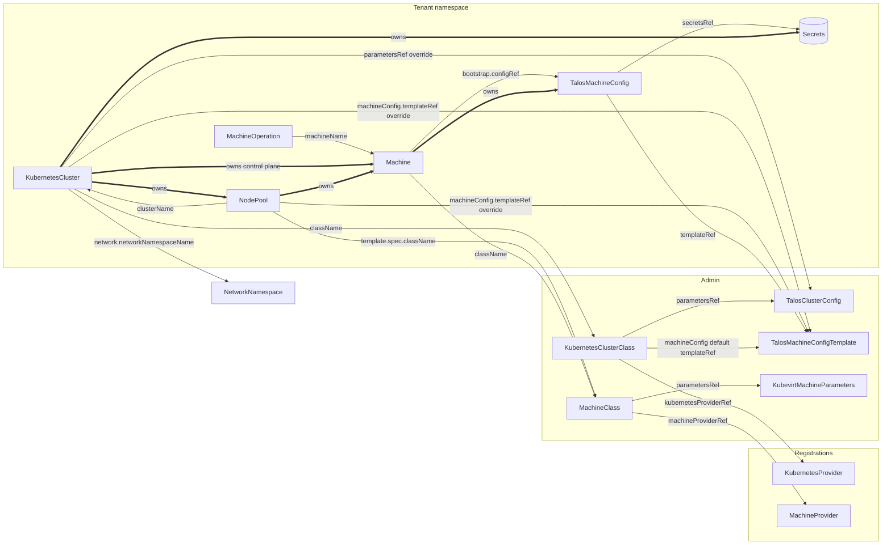

# CRD overview: ownership, status writers and relations

| | |
|---|---|
| **Status** | Draft / for discussion |
| **Builds on** | [kubernetes-native-cluster-machine-api.md](kubernetes-native-cluster-machine-api.md), [physical-machines.md](physical-machines.md), [migration-talos.md](migration-talos.md) |
| **Date** | 2026-10-13 |

Every custom resource mentioned in the proposals, who writes it and how it relates to the others. Section numbers (§) refer to the main proposal unless stated otherwise.

Each CRD has an example in [examples/](examples/) (`<kind>.md`, lower case): a fully documented specification followed by a minimal config. `NetworkNamespace` is unchanged and has none.

## 1. Actors

| Actor | Implemented by (today's operators) | Role |
|---|---|---|
| **User** | Tenant, GitOps | Writes `KubernetesCluster`, standalone `NodePool`, `MachineOperation`, tenant templates |
| **Platform admin** | Platform team | Writes classes, shared templates, provider parameters, `PhysicalHost` |
| **Admission** | CEL in CRDs, `ValidatingAdmissionPolicy`, defaulting webhook | Validates and defaults; never reconciles |
| **Topology controller** | Generic (location open, §13 #2) | Generates NodePools from `KubernetesCluster.spec.workers.pools` |
| **NodePool controller** | Generic (location open, §13 #2) | Creates and rolls worker Machines and their OS config objects |
| **Cluster provider** | talos-operator | Implements `KubernetesCluster`; owns control-plane Machines |
| **Machine provider** | kubevirt-operator; bare-metal provider (future) | Implements `Machine`: VM or host |
| **OS provider** | talos-operator (new OS-provider controller) | Implements OS config objects; delivers and applies OS configuration |

## 2. Catalogue

| Kind | Group | Scope | Generic | Spec written by | Status written by | Scope of work |
|---|---|---|---|---|---|---|
| `KubernetesClusterClass` | `vitistack.io` | Cluster | Yes | Platform admin | Cluster provider named in `controllerName` | Initial |
| `KubernetesCluster` | `vitistack.io` | Namespace | Yes | User (admission defaults `osVersion`) | Cluster provider; `status.workers` by topology controller | Initial (replaces today's type) |
| `NodePool` | `vitistack.io` | Namespace | Yes | User (standalone) or topology controller (generated); `/scale` by autoscaler or user | NodePool controller | Initial |
| `MachineClass` | `vitistack.io` | Cluster | Yes | Platform admin | Machine provider named in `controllerName` | Initial (changes meaning) |
| `Machine` | `vitistack.io` | Namespace | Yes | Owner: NodePool controller, cluster provider, or user (no cluster) | Machine provider, OS provider, cluster provider (§5.2) | Initial (changes) |
| `KubernetesProvider` | `vitistack.io` | Cluster | Yes | Provider operator | Provider operator | Exists; kept (§3.1) |
| `MachineProvider` | `vitistack.io` | Cluster | Yes | Provider operator | Provider operator | Exists; kept (§3.1) |
| `MachineOperation` | `vitistack.io` | Namespace | Yes | User | Provider handling the operation type (not yet specified) | Optional (§13 #7) |
| `TalosClusterConfig` | `talos.vitistack.io` | Either | No | Platform admin (class default) or user (per-cluster override) | — (read only) | Initial |
| `TalosMachineConfigTemplate` | `talos.vitistack.io` | Namespace | No | Platform admin (class defaults) or user (overrides) | — (no status) | Initial |
| `TalosMachineConfig` | `talos.vitistack.io` | Namespace | No | Owner of the Machine (NodePool controller or cluster provider) | OS provider | Initial |
| `KubevirtMachineParameters` | `kubevirt.vitistack.io` | Namespace or cluster (open) | No | Platform admin | — (read only) | Initial |
| `PhysicalHost` | `baremetal.vitistack.io` | Cluster | No | Platform admin; `consumerRef` by bare-metal provider | Bare-metal provider | Future ([physical-machines.md](physical-machines.md)) |
| `BareMetalMachineParameters` | `baremetal.vitistack.io` | Namespace or cluster (open) | No | Platform admin | — (read only) | Future |
| `NetworkNamespace` | `vitistack.io` | Namespace | Yes | Existing; unchanged | Existing | Referenced only |

## 3. Relations

Thin arrows are references (`*Ref`, `*Name`); thick arrows are `ownerReferences` (garbage collection).

### 3.1 References

| From | Field | To | Rules |
|---|---|---|---|
| `KubernetesCluster` | `spec.className` | `KubernetesClusterClass` | Immutable |
| `KubernetesCluster` | `spec.parametersRef` | `TalosClusterConfig` | Optional; replaces the class value |
| `KubernetesCluster` | `spec.controlPlane.machineConfig.templateRef`, `spec.workers.machineConfig.templateRef`, `spec.workers.pools[].machineConfig.templateRef` | OS config template | Optional; same namespace; most specific wins (§6.1) |
| `KubernetesCluster` | `spec.controlPlane.machineClassName`, `spec.workers.pools[].machineClassName` | `MachineClass` | |
| `KubernetesCluster` | `spec.network.networkNamespaceName` | `NetworkNamespace` | |
| `KubernetesClusterClass` | `spec.kubernetesProviderRef` | `KubernetesProvider` | `providerType` must match `controllerName` (§3.1) |
| `KubernetesClusterClass` | `spec.parametersRef` | `TalosClusterConfig` | Any namespace |
| `KubernetesClusterClass` | `spec.machineConfig.{controlPlane,workers}.templateRef` | OS config template | Any namespace; kind must be in `allowedKinds` |
| `NodePool` | `spec.clusterName` | `KubernetesCluster` | Same namespace |
| `NodePool` | `spec.template.spec.className` | `MachineClass` | |
| `NodePool` | `spec.template.spec.machineConfig.templateRef` | OS config template | Same namespace |
| `MachineClass` | `spec.machineProviderRef` | `MachineProvider` | One backend per class |
| `MachineClass` | `spec.parametersRef` | `KubevirtMachineParameters`, `BareMetalMachineParameters` | Provider-specific |
| `Machine` | `spec.className` | `MachineClass` | Immutable |
| `Machine` | `spec.clusterName` | `KubernetesCluster` | Optional |
| `Machine` | `spec.bootstrap.configRef` | `TalosMachineConfig` (any OS config kind) | Same namespace; immutable |
| `Machine` | `status.nodeRef` | `Node` in the workload cluster | Written by cluster provider |
| `Machine` | `status.hostRef` | `PhysicalHost` | Future; written by bare-metal provider |
| `TalosMachineConfig` | `spec.templateRef` | `TalosMachineConfigTemplate` | Record of origin |
| `TalosMachineConfig` | `spec.secretsRef` | `<cluster>-talos-secrets` | Read only by the OS provider |
| `TalosMachineConfig` | `status.dataSecretName` | `<machine>-bootstrap` | Read by the machine provider |
| `PhysicalHost` | `spec.consumerRef` | `Machine` | Future; set with optimistic locking |
| `PhysicalHost` | `spec.bmc.credentialsSecretRef` | BMC Secret | Admin namespace |
| `MachineOperation` | `spec.machineName` | `Machine` | Same namespace |

### 3.2 Ownership (garbage collection)

| Child | Owner (`ownerReferences`, `controller: true`) | Deleted when |
|---|---|---|
| Generated `NodePool` (`<cluster>-<pool>`) | `KubernetesCluster` | The pool is removed from the spec, or the cluster is deleted |
| Control-plane `Machine` | `KubernetesCluster` | Scaled down, replaced in a rollout, or the cluster is deleted |
| Worker `Machine` | `NodePool` | Scaled down, replaced in a rollout, or the pool is deleted |
| `TalosMachineConfig` | `Machine` | The Machine is deleted |
| `<machine>-bootstrap` Secret | `TalosMachineConfig` | The OS config object is deleted |
| `<cluster>-kubeconfig`, `<cluster>-ca`, `<cluster>-talos-secrets` | `KubernetesCluster` | The cluster is deleted |

Not owned by anything: classes, registrations, templates, provider parameters, standalone NodePools, `PhysicalHost`, `MachineOperation`.

### 3.3 Finalizers

| Object | Finalizer | Added by | Removed when |
|---|---|---|---|
| `Machine` | `kubevirt.vitistack.io/machine` (or the bare-metal equivalent) | Machine provider | VM deleted (or host wiped and released); only once it is the **last** finalizer |
| `Machine` | `talos.vitistack.io/node-cleanup` | Cluster provider | Node drained, etcd member removed, VIP updated |

## 4. Per resource

### 4.1 `KubernetesClusterClass` (§4.1)

- **Purpose:** what users can request: implementation, default parameters, default OS config templates, default `osVersion`. Holds no versions of running clusters.
- **Spec:** platform admin. Mutable; changes to default template references roll out (§6.1), the default `osVersion` affects only new clusters (§10.1).
- **Status:** `Accepted` condition (`ProviderMismatch`, `ProviderNotAvailable`), written by the cluster provider that matches `controllerName`.
- **Watched by:** cluster provider, NodePool controller (template resolution).

### 4.2 `KubernetesCluster` (§4.2)

- **Purpose:** a cluster. Nothing provider-specific in it.
- **Spec:** user. `className` immutable; `version` never lowered; `osVersion` defaulted from the class at creation.
- **Status:**

  | Field | Writer |
  |---|---|
  | `version`, `osVersion`, `endpoint`, `kubeconfigSecretRef`, `controlPlane.*`, conditions `Accepted`, `EndpointReady`, `ControlPlaneReady`, `Upgrading`, `Ready` | Cluster provider |
  | `workers.pools[]` | Topology controller |

- **Owns:** generated NodePools, control-plane Machines, cluster Secrets.
- **Watched by:** cluster provider, topology controller, NodePool controller (version defaults), all child controllers (`spec.paused`).

### 4.3 `NodePool` (§4.3, §4.4)

- **Purpose:** a set of identical worker Machines; `/scale` subresource.
- **Spec:**

  | Field | Writer |
  |---|---|
  | All fields of a standalone pool | User |
  | Fields copied from the cluster's pool entry (generated pool) | Topology controller (field manager `vitistack-topology`); direct edits rejected |
  | `replicas` of an `Autoscaled` or standalone pool | Autoscaler or user via `/scale` |

- **Status:** NodePool controller (`replicas`, `readyReplicas`, `updatedReplicas`, `selector`, `machineConfigTemplateRef`, `Ready`, `Accepted`).
- **Owns:** worker Machines. **Creates** one `TalosMachineConfig` per Machine (owned by the Machine).

### 4.4 `MachineClass` (§5.1)

- **Purpose:** size plus backend: `controllerName`, `machineProviderRef`, resources, `parametersRef`.
- **Spec:** platform admin.
- **Status:** `Accepted`, written by the machine provider that matches `controllerName`.

### 4.5 `Machine` (§5.2)

- **Purpose:** one VM or host. Mostly immutable; replaced rather than edited.
- **Spec:** owner (NodePool controller, cluster provider, or user). Immutable except `providerID`, set once by the machine provider. Holds no versions.
- **Status** (server-side apply, one field manager each):

  | Writer | Fields and conditions |
  |---|---|
  | Machine provider | `addresses`, `hardware`, `providerID`, `hostRef` (bare metal), `InfrastructureReady`, `Ready` |
  | OS provider | `versions`, `BootstrapReady`, `OSConfigured` |
  | Cluster provider | `nodeRef`, `NodeHealthy` |

- **Owns:** its OS config object.

### 4.6 `KubernetesProvider` / `MachineProvider` (§3.1)

- **Purpose:** metadata registrations of what a provider offers in this datacenter; sent upstream for visualisation.
- **Spec and status:** the provider operator. Never written by users; no desired state for clusters or machines.
- **Referenced by:** classes.

### 4.7 `MachineOperation` (§8)

- **Purpose:** one-off actions (`Reboot`, `Reset`, `ReapplyConfig`), like a Job.
- **Spec:** user. **Status:** `Complete` condition, written by whichever provider handles the type. The split (machine provider for power actions, OS provider for `ReapplyConfig`) is not yet specified.

### 4.8 `TalosClusterConfig`

- **Purpose:** Talos provider parameters: cluster-wide Talos settings, required system extensions, cluster add-ons (CNI, CSI, manifests). Replaces operator environment variables and the global tenant ConfigMap ([migration-talos.md](migration-talos.md) §2).
- **Spec:** platform admin (referenced by the class) or user (per-cluster override). **Status:** none.
- **Watched by:** cluster provider, OS provider.

### 4.9 `TalosMachineConfigTemplate` (§6.2)

- **Purpose:** Talos machine configuration for a control plane or pool: image (`platform`, `addons`, `extraKernelArgs`), install, kernel, kubelet, registries, time, `configPatches`. No version.
- **Spec:** platform admin (class defaults) or user (overrides). **Status:** none.
- **Read by:** cluster provider and NodePool controller when creating `TalosMachineConfig` objects; changes to its `generation` roll out (§6.1).

### 4.10 `TalosMachineConfig` (§6.2)

- **Purpose:** the OS configuration of one Machine.
- **Spec:** owner of the Machine. Copy of the template's `spec.template.spec` plus `clusterName`, `machineName`, `role`, `version`, `osVersion`, `templateRef`, `secretsRef`. Updated in place for `InPlace` rollouts.
- **Status:** OS provider. Generic contract: `ready`, `dataSecretName`, `dataFormat`, `image`, `lifecycle`, `renderedHash`, `appliedHash`, conditions (`RequiresReplacement`, `Accepted`). Talos-specific: `schematicID`, `addons`.
- **Owns:** `<machine>-bootstrap` Secret.
- **Read by:** machine provider (status only, through `Machine.spec.bootstrap.configRef`).

### 4.11 `KubevirtMachineParameters` / `BareMetalMachineParameters`

- **Purpose:** machine-provider parameters behind a `MachineClass` (KubeVirt settings; for bare metal: host selector, boot method, supported bootstrap formats, reclaim policy).
- **Spec:** platform admin. **Status:** none. **Read by:** the matching machine provider.

### 4.12 `PhysicalHost` (future, [physical-machines.md](physical-machines.md) §3)

- **Purpose:** inventory of one server; claimed by a Machine (PersistentVolume pattern).
- **Spec:** platform admin; `consumerRef` set and cleared by the bare-metal provider.
- **Status:** bare-metal provider (`state`, `powerState`, `hardware` from inspection, `Inspected`, `BMCReachable`).

## 5. Secrets

Not CRDs, but part of the relations (§7).

| Secret | Owner | Written by | Read by |
|---|---|---|---|
| `<cluster>-kubeconfig` | `KubernetesCluster` | Cluster provider | Users, tooling |
| `<cluster>-ca` | `KubernetesCluster` | Cluster provider | Cluster provider |
| `<cluster>-talos-secrets` | `KubernetesCluster` | Cluster provider | OS provider |
| `<machine>-bootstrap` | `TalosMachineConfig` | OS provider | Machine provider only |
| BMC credentials | — | Platform admin | Bare-metal provider |

## 6. Inconsistencies found in the proposals (fixed)

| # | Where | Issue | Fix applied |
|---|---|---|---|
| 1 | Main proposal §7 | Said every Secret is owned by `KubernetesCluster`, but §6.2 garbage-collects `<machine>-bootstrap` with the `TalosMachineConfig` | §7 now lists an owner per Secret; `<machine>-bootstrap` is owned by the OS config object |
| 2 | [migration-talos.md](migration-talos.md) §2 | "Talos version in `TalosClusterConfig` / machine config templates" | Now `spec.osVersion`, pinnable per pool |
| 3 | Main proposal §4.2, §5.1; [physical-machines.md](physical-machines.md) §4.1 | `parametersRef` without `group` | `group` added |
| 4 | Main proposal §4.1, §5.1 | Class `Accepted` status had no stated writer | Written by the provider matching `controllerName` |
